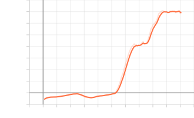
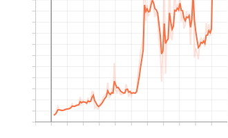
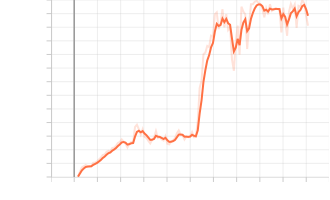
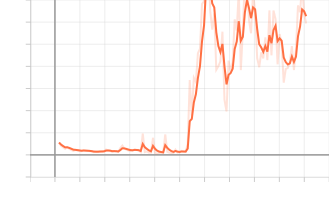
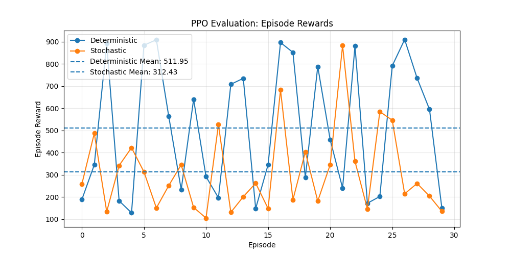

# Lap Zero

## Description & Motivation

Lap Zero is a baseline reinforcement learning project focused on training an autonomous racing agent using Gymnasium's `CarRacing-v3` environment and Proximal Policy Optimization (PPO).

The goal is to establish a working baseline and investigate how different CNN architectures influence the agent's training process and driving performance.

## Background

- **CarRacing-v3:** A visual racing environment where an agent learns to navigate a procedurally generated track.
- **PPO:** A policy-gradient reinforcement learning algorithm that learns driving behaviour through repeated interactions with the environment.
- **CNN:** Processes visual observations and extracts features used by the agent to select actions.

## How to Replicate

All training, evaluation, and visualization code is provided in the Jupyter notebook.

**Prerequisites:**
- Python and dependencies listed in `requirements.txt`.
- Box2D system dependencies (`swig` and `build-essential` on Ubuntu).
- Kaggle is recommended if local installation of Gymnasium's Box2D dependencies causes issues.

**Setup:**

```bash
pip install -r requirements.txt
```

If using Kaggle, install the additional system dependencies:

```bash
apt-get update && apt-get install -y swig build-essential
```

**Before running:**
- Update `model_dir` to specify where training outputs and logs should be saved.
- Update `model_file` to point to the trained PPO model when loading for evaluation.
- Training uses 4 parallel environments and a random seed of 42.
- The baseline uses 1 million timesteps and `ent_coef=0.01`.

## Model Training

The agent was trained for **1 million timesteps** using Stable-Baselines3 PPO with the default `CnnPolicy` and discrete actions.

Most hyperparameters were left at their defaults, with the exception of `ent_coef=0.01` to encourage exploration. This adjustment produced noticeably better performance during experimentation.

### Training Observations

Training behaviour was monitored using TensorBoard.

**Episode Length (`rollout/ep_len_mean`)**

- Remained relatively stable around 995 timesteps, with occasional minor dips.
- Most episodes reached the environment's 1,000-step limit.

**Episode Reward (`rollout/ep_rew_mean`)**

- Rewards showed noticeable improvements throughout training.
- A particularly significant increase occurred around 500k timesteps, suggesting the agent had discovered more effective driving strategies.



**Model Confidence**
Around 500k timesteps, the agent appears to have discovered more effective driving strategies, resulting in a noticeable reward increase. The simultaneous rise in approximate KL suggests larger policy updates during this period, while the decrease in entropy suggests the agent was becoming more confident in its actions.

`train/approx_kl`

`train/entropy_loss`



The increase in value loss may indicate that the critic was temporarily struggling to estimate the higher returns produced by the improving policy. This is a possible explanation rather than a confirmed cause.

$$
V(s_t) = \mathbb{E}\left[\sum_{k=0}^{\infty}\gamma^k r_{t+k}\right]
$$

- Value loss measures the difference between predicted values and observed returns:

$$
L_{\text{value}} = \mathbb{E}\left[(V(s_t)-R_t)^2\right]
$$

- One possible explanation is that the agent's improved driving behaviour resulted in returns that the critic had not yet learned to predict accurately.

`train/value_loss`


## Model Evaluation

The trained model was evaluated over **30 episodes** using both deterministic and stochastic action selection.

| Metric | Deterministic | Stochastic |
|---|---:|---:|
| Mean reward | 503.63 | 303.30 |
| Reward standard deviation | 284.7 | 183.1 |
| Mean episode length | 996.3 | 1000 |



Deterministic evaluation performed better on average, suggesting that selecting the most probable action produced more effective driving behaviour than sampling from the policy distribution.

Both approaches showed considerable reward variability, leaving room for further improvements in consistency and generalization.